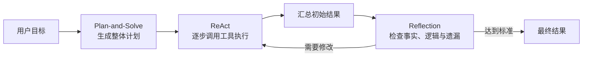

# 第四章：智能体经典范式构建

本章从“如何组织智能体的思考与行动”出发，介绍三种经典范式：**ReAct、Plan-and-Solve 和 Reflection**。它们分别解决三个关键问题：如何根据外部反馈行动、如何保持复杂任务的整体结构，以及如何检查并提升结果质量。

## 1. 从一次模型调用到智能体循环

普通的大语言模型调用可以理解为“输入一次，输出一次”。智能体则需要围绕目标持续维护状态，根据反馈决定下一步行动，并在满足停止条件后结束任务。因此，构建智能体时真正需要设计的是一个可控的循环：

```text
目标 → 决策 → 行动 → 获取反馈 → 更新状态 → 再次决策 → 完成
```

一个可运行的智能体通常包含以下组件：

- **LLM 客户端**：负责理解任务、推理、规划和生成结构化指令。
- **提示词模板**：定义角色、目标、约束、工具说明与输出格式。
- **工具系统**：把搜索、计算、代码执行或 API 等外部能力提供给模型。
- **状态与记忆**：保存任务、历史步骤、中间结果、错误和反馈。
- **输出解析器**：把模型生成的文本转换成程序可以执行的数据。
- **循环控制器**：负责执行工具、更新状态、限制步数并判断何时结束。

工程上应将模型配置和 API Key 放在 `.env` 中，并通过统一的 LLM 客户端封装请求、异常、超时和重试。这样，上层 Agent Loop 不需要依赖某一家模型服务。

工具也不应只是一个函数。一个完整工具至少需要包含名称、功能描述、参数结构和执行函数：

```python
tools = {
    "search": {
        "description": "搜索实时信息",
        "parameters": {"query": "string"},
        "callable": search,
    }
}
```

工具描述是模型决策上下文的一部分。描述含糊、参数不明确或返回值混乱，都会直接降低工具调用成功率。

## 2. ReAct：在推理与行动之间循环

### 2.1 核心动机

仅使用思维链时，模型可以分步推理，却无法获取实时信息或执行真实操作；如果模型直接生成行动，又可能缺少规划与纠错能力。ReAct 将 **Reasoning（推理）** 与 **Acting（行动）** 结合，让外部工具的真实结果反过来修正模型的判断。

<p align="center">
  
</p>

ReAct 的基本轨迹是：

```text
Thought：分析当前信息，决定下一步做什么
Action：选择工具，并生成调用参数
Observation：接收工具返回的结果
Thought：根据新结果调整判断
...
Final Answer：信息充分后输出最终答案
```

这里最重要的不是让模型“多想几次”，而是让推理获得外部事实反馈。搜索结果可以补充时效性知识，计算器可以避免算术错误，数据库和业务 API 则让智能体真正改变环境。

### 2.2 运行流程

一次 ReAct 循环可以拆成以下步骤：

1. 将用户任务、工具说明和历史轨迹组合成提示词。
2. 调用 LLM，要求输出下一步的 Thought 与 Action。
3. 解析工具名称和参数，并验证格式。
4. 执行工具，将结果包装成 Observation。
5. 将 Action 与 Observation 追加到任务状态。
6. 再次调用 LLM，直到模型输出 Final Answer 或达到停止条件。

简化后的控制逻辑如下：

```python
trajectory = []

for step in range(max_steps):
    response = llm(task, tools, trajectory)

    if response.is_final:
        return response.answer

    action = validate(response.action)
    observation = execute_tool(action)
    trajectory.append((response.thought, action, observation))

raise MaxStepsExceeded()
```

### 2.3 输出解析与工具执行

教学示例常用固定文本格式配合正则表达式解析，但生产系统更适合使用 JSON Schema 或模型原生的 Tool Calling。结构化输出可以减少以下问题：

- 模型遗漏 `Action` 字段。
- 工具名称拼写错误。
- 参数类型不正确。
- 模型在工具指令前后加入额外说明，导致解析失败。

工具执行前必须验证参数，执行后应统一返回结构，例如：

```json
{
  "ok": true,
  "data": {},
  "error": null
}
```

这样模型可以区分“工具成功但没有数据”和“工具本身执行失败”，并据此调整下一步。

### 2.4 优势、局限与调试

ReAct 的优势主要体现在：

- 能够获取实时信息，并使用模型自身不具备的能力。
- 根据 Observation 动态修改后续行动，具有较好的环境适应性。
- 执行轨迹相对透明，便于定位工具选择和参数生成问题。
- 适合搜索、计算、数据库查询和多 API 协作等探索性任务。

它也存在明显局限：

- 多轮串行调用会增加延迟和 Token 成本。
- 强依赖模型的指令遵循、工具选择和结构化输出能力。
- 上下文随轨迹增长，可能挤占有效信息空间。
- “走一步看一步”缺少全局规划，可能重复尝试或陷入局部最优。
- 没有步数与权限限制时，可能形成死循环或执行不安全操作。

调试时应记录完整提示词、模型原始输出、解析结果、工具输入输出和每轮耗时。常见改进包括使用低温度、加入少量成功示例、限制最大步数、设置工具超时，以及为有副作用的操作加入人工确认。

## 3. Plan-and-Solve：先谋后动

### 3.1 核心动机

ReAct 善于根据即时反馈调整行动，但复杂任务如果始终只决定“下一步”，容易遗漏整体约束。Plan-and-Solve 将规划和执行解耦：先生成覆盖全局的计划，再按照计划逐步求解。

<p align="center">
  
</p>

其流程可以表示为：

```text
原始任务 → Planner 生成步骤列表 → Executor 逐步执行 → 汇总最终结果
```

### 3.2 规划阶段

Planner 不直接回答问题，而是完成任务分解。一个高质量计划需要满足：

- **完整性**：覆盖目标、约束和最终交付物。
- **可执行性**：每一步都能由模型或工具实际完成。
- **顺序正确**：依赖上一步结果的任务必须放在后面。
- **粒度适中**：步骤太大难以执行，太小则增加调用次数与管理成本。
- **格式稳定**：使用 JSON 或列表，方便程序解析。

例如，面对“根据多份资料撰写调研报告”的任务，计划可以拆成：明确问题、收集资料、验证来源、按主题归纳、生成初稿、检查引用和形成结论。

### 3.3 执行器与状态管理

Executor 每次只处理当前步骤，但必须知道它在全局计划中的位置。因此，执行提示词通常需要包含：

- 原始目标与限制条件。
- 完整计划。
- 当前步骤。
- 已完成步骤及中间结果。
- 当前允许使用的工具。

状态对象可以设计为：

```python
state = {
    "task": original_task,
    "plan": steps,
    "current_step": 0,
    "results": [],
    "errors": [],
    "status": "running",
}
```

执行器完成一步后更新 `results` 和 `current_step`，再将历史结果提供给下一步。这样，中间结论不会散落在对话文本里，而是成为可以检查和恢复的显式状态。

### 3.4 重新规划

最简单的 Plan-and-Solve 会严格执行原计划，但现实环境可能变化，工具也可能失败。因此，更稳健的系统需要 Replanning：

- 某一步连续失败时，修改工具或替代路径。
- 新观察推翻计划假设时，重新生成剩余步骤。
- 发现遗漏约束时，在计划中插入补充任务。
- 重新规划时保留已验证结果，避免从头执行。

这说明 Plan-and-Solve 并不一定是完全静态的。它可以保持全局结构，同时在必要时局部调整。

### 3.5 优势与局限

Plan-and-Solve 的优势是目标一致性强、步骤结构清楚、便于观察进度，适合多步数学推理、报告写作、代码开发和流程明确的复杂任务。

它的主要风险是“计划错，后面跟着错”。初始计划基于不充分信息时，严格执行反而会扩大偏差；过度细化也会导致大量模型调用。因此，实际系统应验证计划质量，并允许在关键节点重新规划。

## 4. Reflection：用反馈迭代结果

### 4.1 核心动机

第一次生成的答案可能基本可用，却仍包含事实错误、逻辑漏洞、遗漏约束或低效实现。Reflection 模拟人类写完初稿后校对和修改的过程，把一次性生成转化为“执行—评审—优化”的循环。

<p align="center">
  
</p>

核心流程是：

1. **Execution**：生成初始方案或完成一轮任务。
2. **Reflection**：评审当前结果，指出具体问题和改进方向。
3. **Refinement**：结合原任务、当前结果与评审反馈生成改进版本。
4. 重复循环，直到达到质量标准或迭代上限。

### 4.2 评审维度

反思不应只是笼统地问“有没有问题”，而要提供可操作的评价标准：

- 事实是否准确，是否需要外部来源验证。
- 推理是否连贯，有无矛盾或跳步。
- 是否遗漏用户要求、边界条件和异常情况。
- 代码是否正确、安全、可读且具有合理复杂度。
- 输出格式是否符合要求。
- 是否存在更简单、更稳定的解决路径。

反思模型最好输出结构化反馈，将问题位置、严重程度、原因和建议分开，便于 Refiner 精确修改。

### 4.3 记忆模块

Reflection 依赖历史轨迹。如果系统不知道上一版内容和评审意见，就无法进行有方向的改进。短期记忆可以保存：

```text
第 1 轮：初始结果 → 评审意见
第 2 轮：改进结果 → 新的评审意见
第 3 轮：最终结果 → 通过条件
```

记忆并非越多越好。完整保存所有文本会迅速消耗上下文窗口，更合理的方式是保留最新版本、关键反馈、已解决问题和仍未解决的问题，并对较早轨迹进行摘要。

### 4.4 停止条件与客观验证

Reflection 不能无限进行，否则模型可能反复改写已经正确的内容。常用停止条件包括：

- 达到最大迭代次数。
- 评审分数达到阈值。
- 连续两轮没有实质改进。
- 所有测试、格式检查或事实验证通过。
- 时间或 Token 成本超过预算。

对于代码任务，应优先使用单元测试、静态检查和性能测试作为外部验证，而不是完全依赖另一个 LLM 的主观评价。对事实型任务，则应结合检索来源或数据库进行核验。

### 4.5 成本与收益

Reflection 可以显著提高复杂任务的准确性、完整性和可靠性，特别适合关键代码、研究报告和高质量决策支持。但每轮通常至少增加一次评审和一次修改调用，因此会明显提高延迟、费用和提示工程复杂度。

它是一种典型的“以成本换质量”策略。实时对话或低风险任务不一定需要多轮反思；质量要求高且允许较长处理时间的任务更适合使用。

## 5. 三种范式如何选择

| 维度 | ReAct | Plan-and-Solve | Reflection |
| --- | --- | --- | --- |
| 核心循环 | 思考—行动—观察 | 规划—逐步执行 | 执行—反思—优化 |
| 主要反馈 | 外部工具和环境 | 中间步骤结果 | 内部评审与测试 |
| 全局规划 | 较弱，偏动态决策 | 强，先建立整体结构 | 取决于初始执行器 |
| 动态适应 | 强 | 中，需要重新规划机制 | 中，侧重结果改进 |
| 调用成本 | 随行动步数增加 | 规划一次，加多步执行 | 每轮包含评审和优化 |
| 典型任务 | 搜索、API、实时信息 | 报告、代码、多步推理 | 代码优化、严谨内容 |
| 主要风险 | 循环、工具误用、局部最优 | 初始计划错误 | 成本高、过度修改 |

可以按照任务的主要矛盾来选择：

- 信息不确定、需要与环境持续交互：优先 **ReAct**。
- 任务结构明确、步骤较多且依赖关系强：优先 **Plan-and-Solve**。
- 初稿容易生成，但最终质量要求很高：加入 **Reflection**。
- 简单任务可以直接调用模型，不必强行套用复杂 Agent Loop。

## 6. 组合范式

复杂任务通常不会只使用一种范式。一个实用组合是先规划、再行动、最后检查：



这种组合同时获得全局结构、环境适应和质量控制，但也会放大系统复杂度。因此必须设置：

- 总步数、每个工具的调用次数和 Token 预算。
- 工具权限、参数校验和有副作用操作的人工确认。
- 超时、重试、降级与中断机制。
- 统一的事件日志，记录计划、行动、反馈、反思和最终输出。
- 可量化的完成标准，避免仅由模型自行判断“任务已经完成”。

## 7. 我的理解

三种范式不是互相替代的算法，而是三种组织智能体行为的思路：

- ReAct 关注智能体如何利用环境反馈决定下一步。
- Plan-and-Solve 关注复杂任务如何保持整体方向和步骤依赖。
- Reflection 关注结果生成后如何发现问题并持续改进。

一个可靠智能体的核心也不是使用了哪一个框架，而是能否清楚回答四个问题：当前状态是什么、反馈从哪里来、下一步如何决定、什么条件下必须停止。只有把状态、反馈、权限和停止条件设计清楚，LLM 的推理能力才能转化为稳定、可控的任务执行能力。

## 参考资料与图片来源

- [Datawhale：第四章 智能体经典范式构建](https://datawhalechina.github.io/hello-agents/#/./chapter4/%E7%AC%AC%E5%9B%9B%E7%AB%A0%20%E6%99%BA%E8%83%BD%E4%BD%93%E7%BB%8F%E5%85%B8%E8%8C%83%E5%BC%8F%E6%9E%84%E5%BB%BA)
- [Hello-Agents 第四章 Markdown 原文](https://github.com/datawhalechina/hello-agents/blob/main/docs/chapter4/%E7%AC%AC%E5%9B%9B%E7%AB%A0%20%E6%99%BA%E8%83%BD%E4%BD%93%E7%BB%8F%E5%85%B8%E8%8C%83%E5%BC%8F%E6%9E%84%E5%BB%BA.md)
- ReAct、Plan-and-Solve 和 Reflection 流程图来自 Datawhale Hello-Agents 开源教程第四章。
