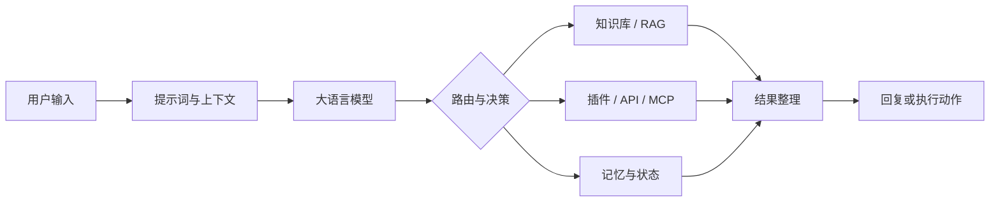
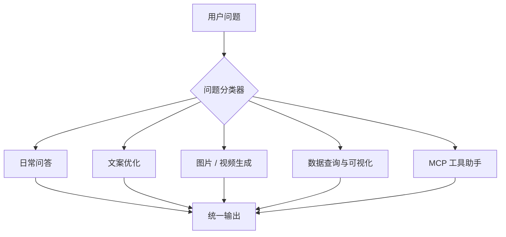
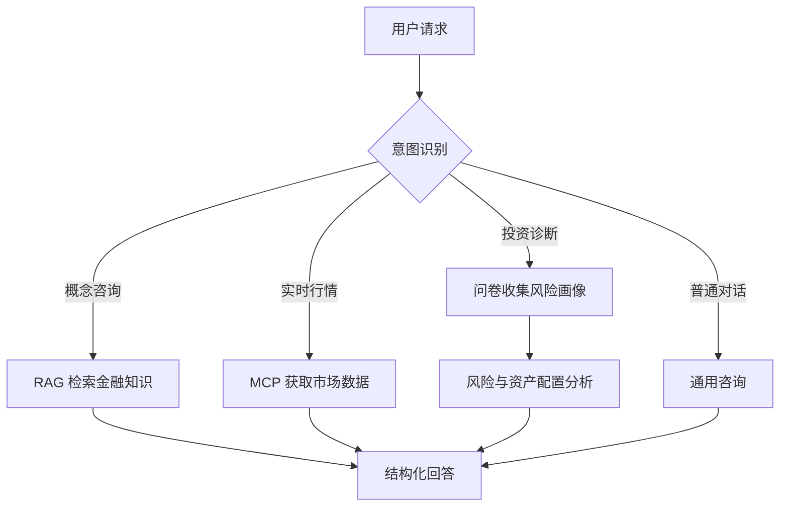
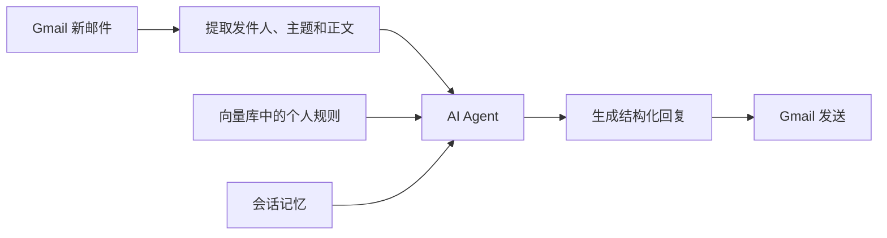
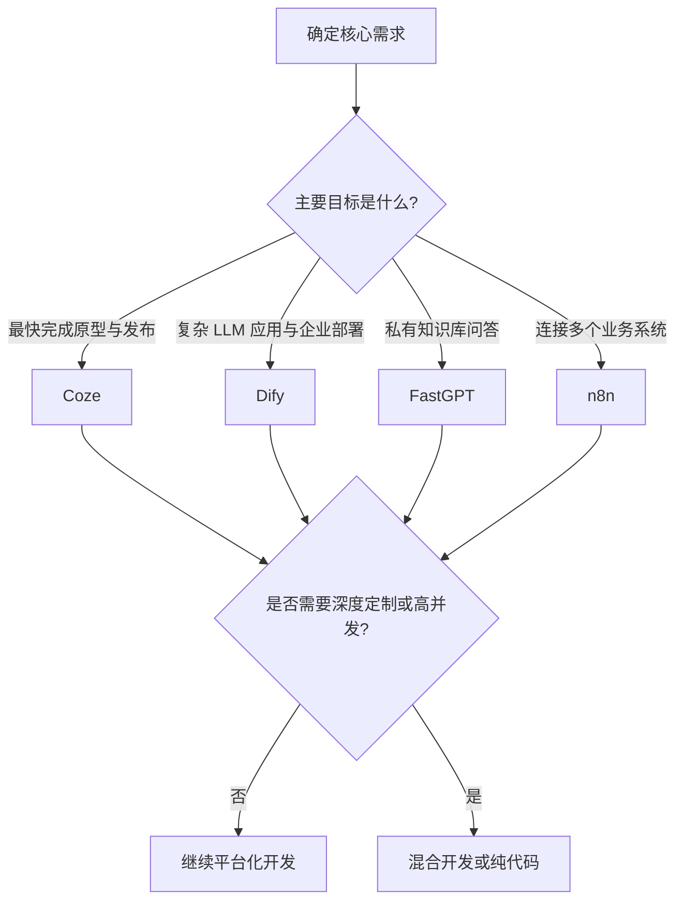

# 第五章：基于低代码平台的智能体搭建

第四章通过代码实现了 ReAct、Plan-and-Solve 和 Reflection，本章进一步学习如何借助低代码平台，把模型、提示词、知识库、工具和业务流程快速组合为可运行的智能体应用。

低代码的价值不是“完全不写代码”，而是提高抽象层级：平台负责通用基础设施，开发者将更多精力放在业务拆解、提示词、数据流和效果评估上。

## 1. 为什么需要低代码平台

纯代码开发控制力强，但随着业务变复杂，还要处理 API 接入、状态管理、异常重试、日志、权限和部署等工程问题。低代码平台把这些通用能力封装为可配置的节点，主要带来四点价值：

- **降低门槛**：产品、运营和领域专家也能参与智能体设计。
- **提升效率**：通过拖拽和配置快速完成原型，缩短验证周期。
- **增强可观测性**：可以直观看到数据流、节点输入输出、耗时和报错位置。
- **沉淀最佳实践**：复用 Agent、RAG、工具调用和工作流模板。

一个低代码智能体的通用结构如下：



可视化画布只是表现形式，真正需要设计的是节点之间的**数据契约**：每个节点接收什么、输出什么、失败后怎么办，以及什么条件下结束流程。

## 2. 四个平台的定位

| 平台 | 核心定位 | 典型场景 | 主要特点 |
| --- | --- | --- | --- |
| Coze | 零代码/低代码智能体产品平台 | 快速原型、内容助手、多渠道 Bot | 上手快、插件多、发布方便 |
| Dify | 开源的 LLM 应用开发与运营平台 | 企业 AI 应用、复杂工作流、多智能体 | 模型中立、编排完整、可私有化 |
| FastGPT | 面向知识库问答的 Agent 平台 | 企业知识助手、客服、垂直问答 | RAG 链路完善、知识库调试细致 |
| n8n | 通用工作流自动化平台 | 邮件、CRM、数据库等业务自动化 | 系统连接能力强、节点生态丰富 |

这四个平台没有绝对优劣，差别主要在于它们优先解决的问题不同：Coze 偏“快速做出并发布产品”，Dify 偏“完整构建 LLM 应用”，FastGPT 偏“让私有知识可被可靠问答”，n8n 偏“让 AI 进入已有业务流程”。

## 3. Coze：快速构建与发布智能体

### 3.1 核心思路

Coze 适合用最低门槛完成从创意到可交互产品的验证。其典型开发方式是：配置角色与提示词，接入插件和知识库，用工作流组织处理步骤，测试后发布到不同渠道。

章节案例是“每日 AI 简报”智能体，核心流程为：

```text
RSS / GitHub / arXiv
        ↓
获取多个信息源的数据
        ↓
筛选 AI 相关内容并去除噪声
        ↓
分类为新闻、论文、开源项目
        ↓
按统一格式生成每日简报
        ↓
测试并发布到目标渠道
```

<p align="center">
  
</p>

### 3.2 实践重点

1. **数据源配置**：RSS 提供媒体文章，GitHub 提供项目动态，arXiv 提供论文信息。
2. **并行获取与统一汇总**：不同来源可以并行执行，最后交给模型统一筛选和整理。
3. **提示词分层**：系统提示定义长期角色、规则和输出格式；用户提示描述本次输入和具体任务。
4. **输出约束**：明确分类、数量、摘要长度、原始链接和排版格式，降低结果随机性。
5. **发布前测试**：检查事实、链接、重复内容、格式完整性和语言风格，再配置头像、欢迎语与预设问题。

### 3.3 优势与局限

优势是上手快、插件生态丰富、可视化程度高，并且适合多渠道分发。局限是复杂插件仍可能需要 API 和编程基础，平台配置的可迁移性、版本管理和深度定制能力弱于纯代码方案。

因此，Coze 最适合验证“这个智能体有没有用户价值”，不一定适合承载所有长期、复杂和高度定制的核心系统。

## 4. Dify：构建模块化的综合智能体

### 4.1 核心思路

Dify 更接近完整的 LLM 应用开发平台。它把模型接入、工作流、知识库、插件、Agent 策略、日志和部署组织在一起，并支持云端或私有化部署。

章节案例是“超级智能体个人助手”。系统先通过问题分类器识别意图，再将任务分发给不同模块：



这种“分类器 + 专用模块”的设计比让一个通用智能体承担所有任务更稳定：每个模块可以使用独立的提示词、模型、工具和输出格式，也更便于测试和迭代。

### 4.2 模块设计

- **日常助手**：处理通用问题，同时作为无法分类时的兜底分支。
- **文案助手**：根据目标受众、用途和语气完成润色、扩写或改写。
- **多模态助手**：调用图片、视频生成插件，并处理异步任务、轮询和文件输出。
- **数据助手**：根据表结构生成查询，整理数据并调用图表工具完成可视化。
- **MCP 助手**：使用 ReAct 策略选择地图、饮食、新闻等外部工具。

数据查询的关键并不只是“连接数据库”，而是让模型正确理解数据结构。当表很多时，不应把所有 DDL 都塞进提示词，更合理的方式是先检索相关表和字段，再把最小必要 Schema 交给模型生成查询。

### 4.3 MCP 的作用

MCP 为智能体连接外部工具提供标准化接口。平台接入 MCP 服务后，模型可以根据工具描述选择能力并生成参数，再由平台执行调用。它降低了“每个平台为每个工具单独适配”的重复成本。

工具接入仍需关注：

- 工具名称和描述是否准确；
- 参数和返回值是否结构化；
- 密钥是否安全保存；
- 是否设置超时、重试和权限边界；
- 工具失败后是否有兜底路径。

### 4.4 优势与局限

Dify 的优势是模型选择灵活、编排能力全面、插件与知识库完整，并支持私有化部署。代价是学习和运维成本高于 Coze；当工作流非常复杂或并发要求很高时，还需要通过自定义代码、外部服务和基础设施补足。

## 5. FastGPT：围绕知识库构建垂直智能体

### 5.1 核心思路

FastGPT 的突出能力是 RAG。完整链路通常包括：

```text
文档导入 → 清洗与分块 → 向量化 → 索引 → 检索 → 重排 → 生成回答
```

RAG 的意义不是让模型“记住文档”，而是在回答时找到相关证据，并把证据作为上下文交给模型，从而提高专业性、可更新性和可追溯性。

知识库效果主要受以下因素影响：

- 分块是否保留完整语义；
- 元数据能否帮助过滤；
- Embedding 模型是否适合文本类型；
- 召回数量和相似度阈值是否合理；
- 是否需要重排模型；
- 最终提示词是否要求基于证据回答并承认未知。

### 5.2 智能投顾助手案例

案例将用户请求划分为多条路径：金融知识问题走知识库检索，实时行情走 MCP 工具，投资诊断走问卷与风险分析，普通对话走通用分支。



<p align="center">
  
</p>

金融场景还说明了一点：提示词除了角色、任务和格式，还必须写清边界，例如不承诺收益、不擅自扩展用户信息、不替代专业意见。高风险领域不能只追求“回答得像专家”，还要设计证据、免责声明和人工复核。

### 5.3 优势与局限

FastGPT 适合企业知识助手、智能客服和文档问答。优势是知识库管理、分块调试和 RAG 编排更聚焦；局限是通用应用模板与业务自动化生态不如综合平台，复杂系统集成仍需要额外开发。

## 6. n8n：让智能体进入真实业务流程

### 6.1 核心思路

n8n 原本就是工作流自动化平台，它的强项是把 Gmail、数据库、CRM、日历和 Webhook 等系统连接起来。加入 AI Agent 节点后，模型负责理解和决策，工作流负责可靠执行。

章节案例是“智能邮件助手”，大致分为两部分：

1. 将个人工作时间、回复策略等资料写入向量存储。
2. 邮件到达后触发 Agent，读取邮件、检索个人规则、生成回复并发送。



<p align="center">
  
</p>

### 6.2 实践重点

- 节点之间通过表达式映射字段，必须确认上游数据结构。
- 向量库写入和读取必须使用一致的 Memory Key 与 Embedding 模型。
- 会话标识应稳定且唯一，例如使用邮件线程 ID。
- Agent 输出最好采用 JSON 等结构化格式，便于下游节点可靠读取。
- 生产环境应使用 Redis、PostgreSQL 或专业向量数据库持久化状态。

### 6.3 优势与局限

n8n 的优势是系统连接能力强、自动化节点多、支持自定义代码和私有化部署。它适合把 AI 嵌入现有流程，而不是只做一个聊天界面。

局限包括：复杂流程排错可能需要逐节点检查；内置简单记忆和向量存储不适合生产持久化；JSON 工作流的版本对比与多人协作不如代码；超高并发场景也需要额外的队列和服务化架构。

## 7. 平台如何选择

选型不能只比较功能数量，应从场景、团队和长期成本出发：



应重点比较以下维度：

- **需求匹配**：平台的核心能力是否覆盖主要业务链路。
- **交付速度**：原型、测试和上线分别需要多久。
- **总成本**：订阅、模型调用、服务器、运维和人员成本。
- **数据安全**：能否私有化、权限是否细致、数据是否会离开受控环境。
- **可维护性**：日志、监控、测试、版本控制和团队协作是否完善。
- **可扩展性**：是否支持自定义节点、API、MCP、代码和外部数据库。
- **平台锁定**：工作流、数据和插件是否可以迁移。

## 8. 低代码智能体的通用设计方法

无论使用哪个平台，都可以遵循同一套设计过程：

1. **定义成功标准**：明确用户、输入、预期输出和质量指标。
2. **拆分任务**：把业务拆成触发、路由、处理、工具、校验和输出节点。
3. **设计数据契约**：明确每个节点的字段、类型和错误格式。
4. **选择模型和工具**：简单任务不必使用最昂贵的模型，关键工具坚持最小权限。
5. **编写提示词**：包含角色、背景、任务、约束、工具规则和输出格式。
6. **加入知识与状态**：区分短期会话记忆、长期业务数据和可检索知识库。
7. **设置异常路径**：处理超时、空结果、工具失败、解析失败和人工接管。
8. **逐节点测试**：先验证单节点，再验证分支，最后做端到端测试。
9. **持续评估**：记录成功率、延迟、成本、事实准确性和用户反馈。

一个可靠工作流不只包含“成功路径”，还必须回答：如果分类错了怎么办？知识库没有证据怎么办？工具返回异常怎么办？模型输出无法解析怎么办？

## 9. 低代码、纯代码与混合开发

| 模式 | 优势 | 局限 | 适用阶段 |
| --- | --- | --- | --- |
| 低代码 | 开发快、可视化、协作门槛低 | 深度定制和版本控制有限 | 原型验证、标准化流程 |
| 纯代码 | 控制力、性能和工程化上限高 | 开发和维护成本高 | 核心系统、高并发、复杂算法 |
| 混合开发 | 兼顾效率与扩展性 | 系统边界和运维更复杂 | 从原型走向生产的多数项目 |

更现实的路线通常是：先用低代码验证需求，再把性能敏感、合规敏感或高度定制的部分做成独立服务，通过 API、Webhook 或 MCP 接回平台。

这说明低代码和第四章的经典范式并不矛盾。第四章解释 Agent Loop 如何工作，第五章则把循环封装为可配置组件。只有理解底层的规划、工具、观察和反思，才能在平台出现异常时判断问题究竟来自模型、提示词、数据、工具还是编排。

## 10. 我的核心收获

1. 低代码的本质是对重复工程工作的封装，而不是消除所有技术复杂度。
2. 智能体质量取决于模型、提示词、知识、工具、流程和评估的共同作用。
3. 平台选型应从业务主线出发，而不是追求功能最多的平台。
4. 多能力助手应通过分类与路由拆成专用模块，避免一个提示词承担所有任务。
5. RAG 解决知识依据问题，工具调用解决实时信息和外部行动问题，二者职责不同。
6. 演示级记忆、权限和异常处理不能直接用于生产环境。
7. 低代码最适合快速验证；走向生产时，混合开发通常更平衡。

## 11. 后续实践清单

- [ ] 选择一个真实需求，先写清输入、输出和成功标准。
- [ ] 分别画出正常路径和至少两条异常路径。
- [ ] 在一个平台完成最小可用原型。
- [ ] 为知识检索准备 5～10 个测试问题，检查召回证据。
- [ ] 为每个工具测试正常、空结果、超时和参数错误。
- [ ] 记录一次运行的模型成本、总耗时和失败节点。
- [ ] 思考哪些节点未来需要替换成代码服务。

---

参考资料：[Datawhale《Hello-Agents》第五章：基于低代码平台的智能体搭建](https://datawhalechina.github.io/hello-agents/#/./chapter5/%E7%AC%AC%E4%BA%94%E7%AB%A0%20%E5%9F%BA%E4%BA%8E%E4%BD%8E%E4%BB%A3%E7%A0%81%E5%B9%B3%E5%8F%B0%E7%9A%84%E6%99%BA%E8%83%BD%E4%BD%93%E6%90%AD%E5%BB%BA)
